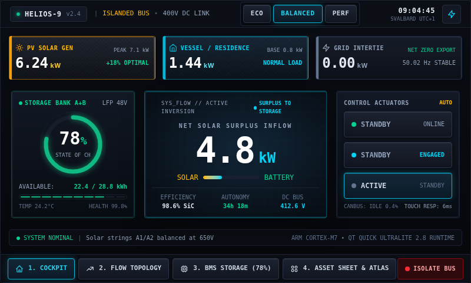

# HELIOS — Energy Management Cockpit

**Designed & Developed by Sandeep Pariyar**  
**Designed in Figma · Built with Qt 6, QML and C++**

A premium embedded-inspired energy cockpit showcasing native Qt Quick interaction, responsive instrumentation and an optimized graphical asset system.

## Experience

- Three connected views: **Cockpit**, **Flow Topology**, **BMS Storage**.
- Native QML animations, custom linear and radial controls, live status indicators and precise native typography.
- A C++ energy simulation model drives PV generation, demand, battery state, inverter behavior, power exchange and safety events.
- ECO / BALANCED / PERF, actuator toggles, simulated bus isolation, alarm acknowledgement and reset.
- Weather and solar-irradiance context from **Open-Meteo**, with a working offline simulator fallback.
- Optional sound cues and a DEV panel for build-footprint statistics and MCU framebuffer estimates.

**This is an interactive simulator, not a real electrical controller.** Electrical and battery telemetry is simulated; external weather is clearly identified. Emergency isolation operates on simulated state only.

## Optimized by design

HELIOS was built with low-resource interfaces in mind. Its graphical resources use **aggressive pre-Qt palette reduction**, reusable image families and nine-slice components, while all ordinary text and changing values remain native QML.

- **60 optimized UI PNGs**
- **15.2 KiB** total source PNG data (this revision)
- Reusable states, tiny backgrounds and image deduplication

These asset optimizations are suitable for MCU-oriented workflows. The public build runs on Qt 6 desktop and WebAssembly, not Qt Quick Ultralite firmware.

## Build locally

**Requirements:** Qt 6.5+ (Qt Quick and Network), CMake 3.21+, C++17. Qt Multimedia is optional.

1. Clone the repository.
2. Open `CMakeLists.txt` in **Qt Creator**.
3. Select a Qt 6 desktop kit (Windows MinGW supported).
4. Configure and run.

CMake uses `NO_CACHEGEN` to avoid MinGW's large-QML-object assembler limitation. At configuration, an optional helper downloads the freely licensed JetBrains Mono and Space Grotesk fonts. Font binaries are not checked into this repository.

## Browser demo (Qt WebAssembly)

The **native QML/C++ WebAssembly demo is live**, built and deployed automatically by GitHub Actions using `.github/workflows/pages.yml`:

**[Launch HELIOS in your browser](https://sandeepariyar.github.io/HELIOS/)**

See [WebAssembly build notes](docs/WEBASSEMBLY.md). The browser edition presents the **real running Qt window** inside an optimized, straight-on MCU-style touchscreen housing. The front-facing enclosure is a visual presentation layer; the controls remain live Qt Quick objects.

**Browser sound:** Click **ENABLE SOUND** once (required by browser autoplay restrictions). The original confirmation, warning and emergency WAV effects are then played through a C++ / Emscripten / Web Audio bridge, without requiring Qt Multimedia on WebAssembly.

## Code

| Folder | Contents |
|---|---|
| `src/` | C++ energy simulation, Open-Meteo networking, state management and application entry point |
| `qml/` | Native QML screens, slider components, nine-slice buttons and DEV metrics panel |
| `assets/` | Optimized PNGs referenced by QML |
| `sounds/` | Short original audio cues |
| `tooling/` | Asset optimization manifest and methodology |
| `references/` | Screenshots |
| `tests/` | Source/asset preflight checks |

## License and attribution

Copyright © 2026 **Sandeep Pariyar**. HELIOS original source code is under the [MIT License](LICENSE). Qt components and downloaded fonts are governed by their respective licenses. Open-Meteo usage is subject to its API terms.

**Designed & Developed by Sandeep Pariyar.**
